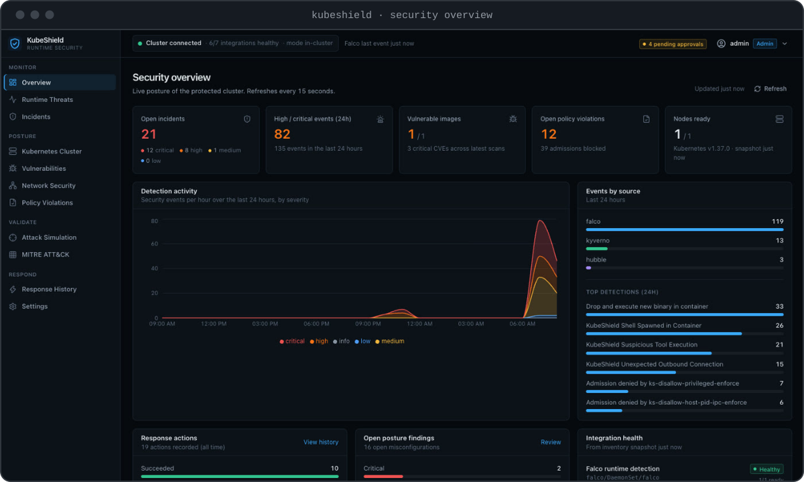
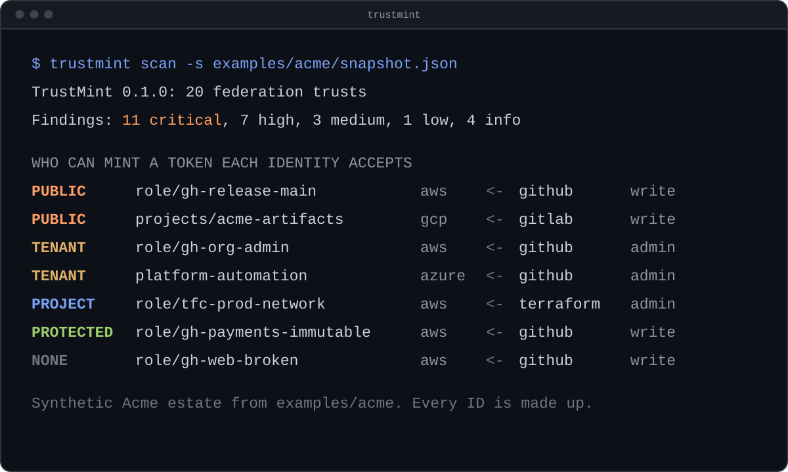
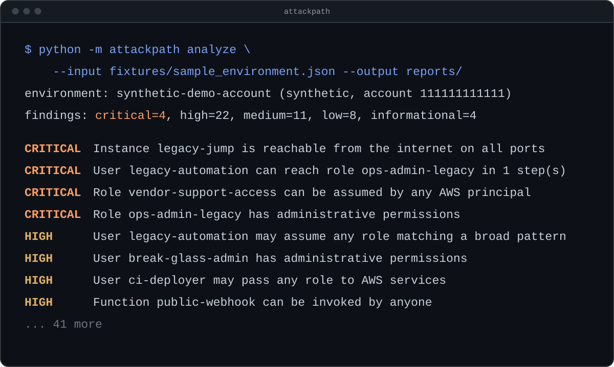
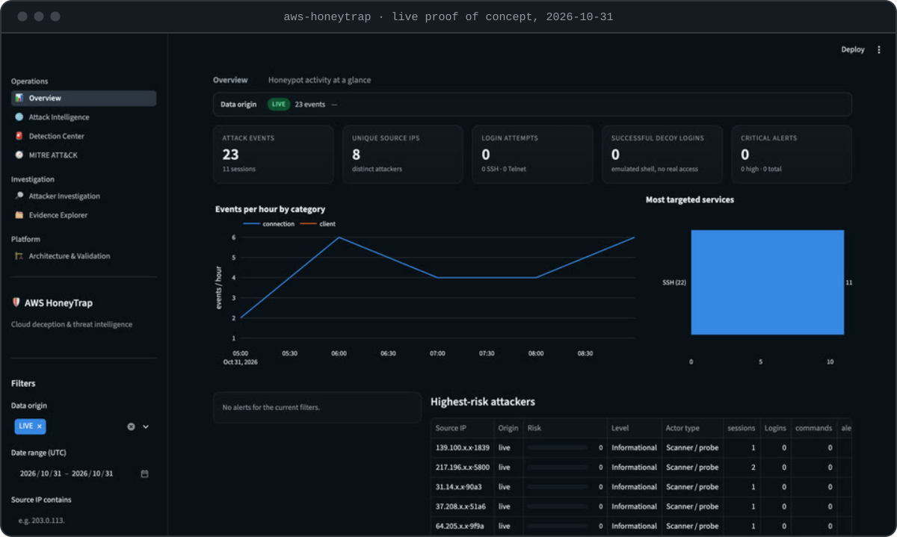
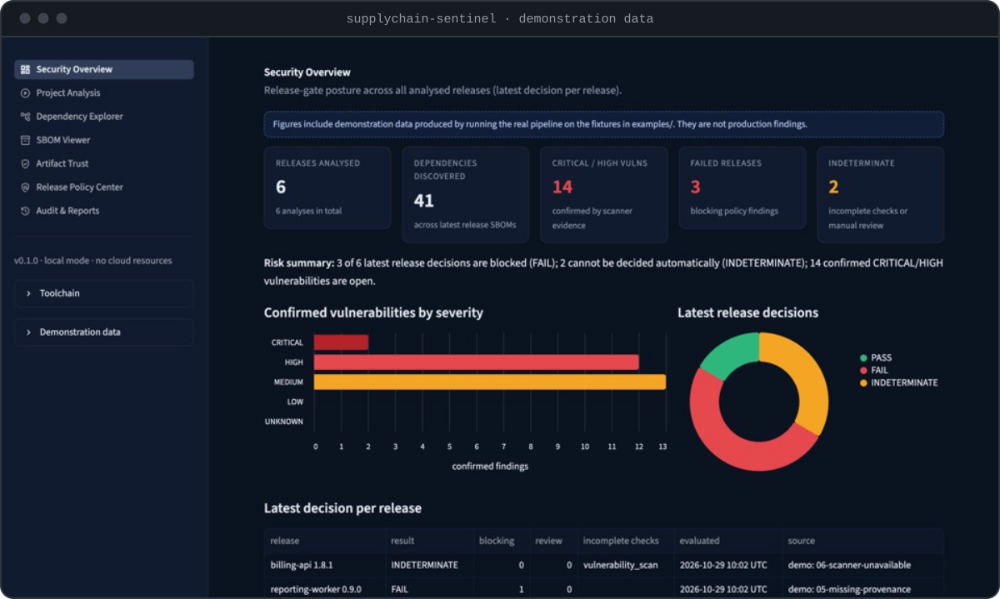

<!--
  Profile README for github.com/ahmedhany-cys

  Layout: banner → who I am → open source → selected work (one flagship, four cards) → toolkit → links.
  Keep it short. A project earns a place here only if a reader can open the evidence behind it.

  Images
    assets/banner-dark.svg, assets/banner-light.svg   GitHub swaps them by theme through <picture>
    assets/work/*.svg                                  one 16:9 cover per project, in a window frame
    scripts/build_assets.py                            rebuilds all of the above (screenshots live in assets/src/)
  Banner: a neural network inside a cloud, in two colourings (ink for dark mode, royal blue for light mode).
  Signals run from blue to orange, and orange means a finding or a risk everywhere on this page.
  Pull request status badges are live from shields.io, so add a row and never edit a status by hand.
-->

  <picture>
    <source media="(prefers-color-scheme: dark)" srcset="./assets/banner-dark.svg" />
    <source media="(prefers-color-scheme: light)" srcset="./assets/banner-light.svg" />
    
  </picture>

 

I'm Ahmed, a cloud security engineer in Dubai. I build tools that answer the questions a security team actually gets asked: *who can reach this data, who can mint a token our cloud trusts, what just happened in this cluster?*

I test them until I can show evidence for every claim they make. When the evidence isn't there, they say **unknown** instead of guessing. And when a scanner I rely on gets a case wrong, I send the fix upstream.

## Open source

Rules and fixes for security scanners that other teams run in production. Each one ships with tests and follows the project's own conventions. The status badges are live.

<table>
  <tr>
    <td width="64" align="center"></td>
    <td>
      <b><a href="https://github.com/kubescape/kubescape/pull/4509">Kubescape</a></b> &nbsp;CNCF · Rego &nbsp; 
      New rule <code>modify-admission-webhooks-v1</code>. It flags RBAC that lets a subject create or change admission webhooks, with test cases for each binding shape.
    </td>
  </tr>
  <tr>
    <td width="64" align="center"></td>
    <td>
      <b><a href="https://github.com/cloud-custodian/cloud-custodian/pull/11317">Cloud Custodian</a></b> &nbsp;CNCF · Python &nbsp; 
      Fix for the <code>cross-account</code> filter. It read fail-open IAM conditions, such as <code>ForAllValues</code> on an absent key, as restrictions and reported public resource policies as safe.
    </td>
  </tr>
  <tr>
    <td width="64" align="center"></td>
    <td>
      <b><a href="https://github.com/awslabs/automated-security-helper/pull/866">ASH</a></b> &nbsp;AWS Labs · Python &nbsp; 
      Fix: say so when <code>uv sync</code> removes the dependencies that <code>ash dependencies install</code> added.
    </td>
  </tr>
  <tr>
    <td width="64" align="center"></td>
    <td>
      <b><a href="https://github.com/prowler-cloud/prowler/pulls?q=is%3Apr+author%3Aahmedhany-cys">Prowler</a></b> &nbsp;Python &nbsp;   
      A <a href="https://github.com/prowler-cloud/prowler/pull/13220">new WAFv2 check</a> for the AWS managed rule groups against injection, and two fixes to how resource policies are judged: <a href="https://github.com/prowler-cloud/prowler/pull/13227">S3 secure-transport deny statements</a> and <a href="https://github.com/prowler-cloud/prowler/pull/13294">wildcard conditions that match any account</a>.
    </td>
  </tr>
  <tr>
    <td width="64" align="center"></td>
    <td>
      <b><a href="https://github.com/aquasecurity/trivy/pull/11520">Trivy</a></b> &nbsp;Go &nbsp; 
      Fix: apply the default TLS policy to ELB listeners that set no <code>ssl_policy</code>, in both the Terraform and CloudFormation adapters.
    </td>
  </tr>
</table>

## Selected work

<code>flagship</code>

### [KubeShield](https://github.com/ahmedhany-cys/kubeshield)

**Kubernetes runtime threat detection with approval-gated response.** Say a container drops a binary, reads its service account token and tries to reach a database in another namespace. KubeShield picks that up from Falco, Hubble and Kyverno, correlates it into one incident, and isolates the pod only after an analyst approves. Then it proves the isolation with real connections instead of trusting that a policy object exists.

<table>
  <tr>
    <td colspan="5">
      
    </td>
  </tr>
  <tr>
    <td width="20%" align="center"><b>46 of 46</b> end-to-end checks passed</td>
    <td width="20%" align="center"><b>9</b> attack scenarios validated</td>
    <td width="20%" align="center"><b>8</b> custom Falco rules</td>
    <td width="20%" align="center"><b>9</b> Kyverno guardrails</td>
    <td width="20%" align="center"><b>62</b> unit tests</td>
  </tr>
</table>

<a href="https://github.com/ahmedhany-cys/kubeshield/blob/main/docs/validation/detection-validation-report.md">Validation report</a> ·
<a href="https://github.com/ahmedhany-cys/kubeshield#problems-found-by-testing-and-fixed">What testing broke</a> ·
<a href="https://github.com/ahmedhany-cys/kubeshield/blob/main/docs/detection-rules.md">Detection rules</a> ·
<a href="https://github.com/ahmedhany-cys/kubeshield/blob/main/docs/architecture.md">Architecture</a> ·
<a href="https://github.com/ahmedhany-cys/kubeshield/blob/main/docs/limitations.md">Limitations</a>
 
A lab project. It runs on a local, loopback-only kind cluster and makes no production-readiness claims.

 

<table>
  <tr>
    <td width="50%" valign="top">
      
        
      <b><a href="https://github.com/ahmedhany-cys/trustmint">TrustMint</a></b> 
      <i>Who can mint a token your cloud trusts?</i>
        
      Offline audit of OIDC workload identity federation from GitHub Actions, GitLab, HCP Terraform, CircleCI and EKS into AWS, GCP and Azure. A finding is reported only when TrustMint can build a <b>witness token</b> the trust really accepts.
        
      <code>Python</code> · <code>OIDC</code> · <code>IAM</code> · <code>CEL</code> · <code>Terraform plans</code> · <code>SARIF</code>
    </td>
    <td width="50%" valign="top">
      
        
      <b><a href="https://github.com/ahmedhany-cys/aws-cloud-attack-path-analyzer">AWS Cloud Attack Path Analyzer</a></b> 
      <i>Who could reach admin or sensitive data?</i>
        
      Offline, graph-based analysis of AWS IAM and network exposure. A tri-state IAM evaluator and <b>22 checks</b> turn misconfigurations into attack paths with least-privilege fixes. Zero runtime dependencies and <a href="https://github.com/ahmedhany-cys/aws-cloud-attack-path-analyzer#testing-and-results">402 tests</a>.
        
      <code>Python</code> · <code>IAM</code> · <code>graph analysis</code> · <code>Hypothesis</code>
    </td>
  </tr>
  <tr>
    <td width="50%" valign="top">
      
        
      <b><a href="https://github.com/ahmedhany-cys/aws-honeytrap">AWS HoneyTrap</a></b> 
      <i>Who is knocking, and what do they try?</i>
        
      A honeypot I put on the real internet. Terraform deployed <b>80 resources</b>, a hardened Cowrie decoy stayed exposed for about 5 hours 20 minutes, then I tore it down and <a href="https://github.com/ahmedhany-cys/aws-honeytrap/blob/main/docs/evidence/live-poc/teardown-verification.txt">checked it was gone</a>. Cost: about $0.10. Scanners came from 8 sources, none logged in, so none of the 18 rules fired, and the <a href="https://github.com/ahmedhany-cys/aws-honeytrap#live-proof-of-concept-aws-2026-10-31">write-up</a> says exactly that.
        
      <code>Python</code> · <code>Terraform</code> · <code>Cowrie</code> · <code>Lambda</code> · <code>EventBridge</code> · <code>Streamlit</code>
    </td>
    <td width="50%" valign="top">
      
        
      <b><a href="https://github.com/ahmedhany-cys/azure-supplychain-sentinel">Azure SupplyChain Sentinel</a></b> 
      <i>Is this release safe to ship?</i>
        
      A release gate that turns SBOM, vulnerability, signature and SLSA provenance evidence into a <b>PASS / FAIL / INDETERMINATE</b> decision under a versioned policy. A scan that could not finish is never read as a clean one.
        
      <code>Python</code> · <code>Syft</code> · <code>OSV</code> · <code>Cosign</code> · <code>SLSA</code> · <code>FastAPI</code>
    </td>
  </tr>
</table>

Every project is open source and tested. Demos use synthetic data or a local lab unless a project says otherwise. The rest of my work is in <a href="https://github.com/ahmedhany-cys?tab=repositories">repositories</a>.

## Toolkit

<table>
  <tr>
    <td width="24%"><b>Cloud</b></td>
    <td>AWS: IAM, CloudTrail, GuardDuty, EventBridge, Lambda, S3 &nbsp;·&nbsp; Azure: Key Vault, Container Registry, Storage</td>
  </tr>
  <tr>
    <td><b>Kubernetes</b></td>
    <td>Falco · Cilium and Hubble · Kyverno · Kubescape · Helm · eBPF</td>
  </tr>
  <tr>
    <td><b>Security engineering</b></td>
    <td>MITRE ATT&amp;CK · OIDC federation · Sigstore and Cosign · SLSA · CycloneDX · SARIF · YARA</td>
  </tr>
  <tr>
    <td><b>Build</b></td>
    <td>Python · Go · TypeScript · Rego · Terraform · FastAPI · React · Docker · GitHub Actions</td>
  </tr>
</table>

 

  <a href="https://github.com/pulls?q=is%3Apr+author%3Aahmedhany-cys+-user%3Aahmedhany-cys">All my pull requests</a> &nbsp;·&nbsp;
  <a href="https://github.com/ahmedhany-cys?tab=repositories">Repositories</a> &nbsp;·&nbsp;
  <a href="https://www.instagram.com/ahmedhany.cys">Instagram</a>

