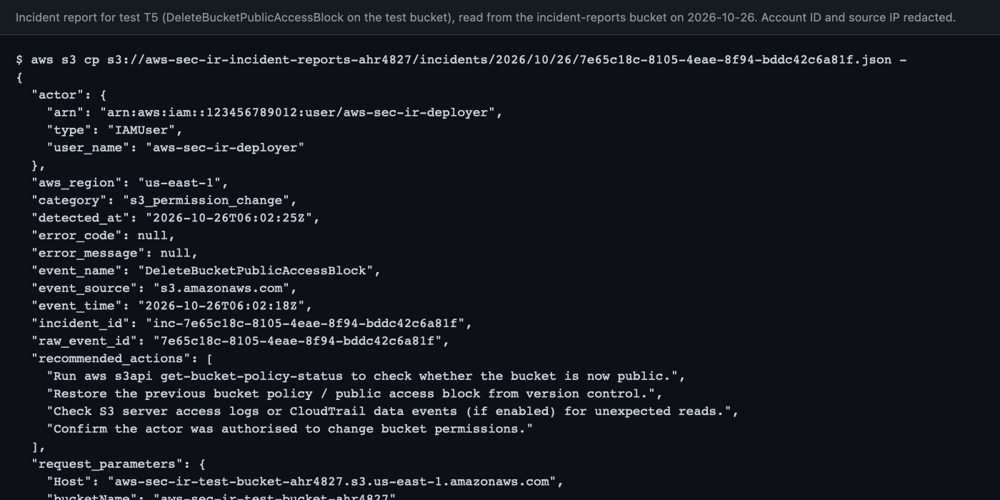

<!--
  Profile README for github.com/ahmedhany-cys

  Identity "Signal" (dark-first)
    ground  #0D1117 / #0B0F15      surface #161B22      border #21262D
    accent  #7AA2F7 (links, titles) alert   #FF9E64 (severity, streak fire only)
    text    #C0CAF5 / #8B949E

  Everything below is real: stats cards are generated live, project claims link to
  the repository docs that back them. To change the rotating headline, edit the
  `lines=` parameter of the typing SVG. The contribution snake is produced by
  .github/workflows/snake.yml on the `output` branch.
-->

<a id="top"></a>

<div align="center">


<a href="https://github.com/ahmedhany-cys/aws-cloud-security-incident-response">
  
</a>

<p>
  <a href="#about-me"></a>
  <a href="#tech-stack"></a>
  <a href="#featured-project"></a>
  <a href="#achievements"></a>
  <a href="#github-statistics"></a>
  <a href="#contact"></a>
</p>

</div>

## About me

I build cloud security tooling on AWS, and I care about proving that a detection works, not just that it deploys. My focus is **detection engineering and automated incident response**: turning CloudTrail activity into structured, actionable incident reports with serverless, least-privilege infrastructure defined entirely in Terraform.

<table>
  <tr>
    <td width="50%" valign="top"><sub><code>building</code></sub><br/>Serverless security monitoring on AWS: CloudTrail → EventBridge → Lambda → S3</td>
    <td width="50%" valign="top"><sub><code>method</code></sub><br/>Every detection is exercised end to end against a live account, with redacted evidence committed next to the code</td>
  </tr>
  <tr>
    <td valign="top"><sub><code>constraint</code></sub><br/>The whole stack runs at $0/month inside the AWS Free Tier</td>
    <td valign="top"><sub><code>interests</code></sub><br/>IAM and least privilege, threat detection, infrastructure as code, security automation</td>
  </tr>
</table>

<details>
<summary><b>Principles I build with</b></summary>
<br/>

Lessons from shipping and testing real detections:

- **Test the detection, not the deployment.** A successful `terraform apply` proves nothing about whether a rule fires. Only an observed incident does.
- **API names are not always event names.** CloudTrail logs `PutBucketPublicAccessBlock`, not `PutPublicAccessBlock`. Validate every pattern against real logged events.
- **Least privilege is a design input, not a cleanup step.** Every role gets exactly the actions and resources it needs, and every unavoidable `*` gets a comment explaining why.
- **Evidence leaks more than account IDs.** Source IPs, access key IDs and principal IDs are redacted before anything is committed.
- **Write down the limitations.** A partial result with a documented cause is worth more than a green check nobody can trust.

</details>

<div align="right"><a href="#top"><sub>back to top ↑</sub></a></div>

## Tech stack

<div align="center">
  
</div>

<br/>

<table>
  <tr>
    <td><b>Languages</b></td>
    <td>
      <a href="https://docs.python.org/3.12/"></a>
      <a href="https://www.gnu.org/software/bash/manual/"></a>
      <a href="https://developer.hashicorp.com/terraform/language"></a>
    </td>
  </tr>
  <tr>
    <td><b>Cloud &amp; security</b></td>
    <td>
      <a href="https://docs.aws.amazon.com/awscloudtrail/latest/userguide/"></a>
      <a href="https://docs.aws.amazon.com/eventbridge/latest/userguide/"></a>
      <a href="https://docs.aws.amazon.com/lambda/latest/dg/"></a>
      <a href="https://docs.aws.amazon.com/AmazonS3/latest/userguide/"></a>
      <a href="https://docs.aws.amazon.com/IAM/latest/UserGuide/"></a>
      <a href="https://docs.aws.amazon.com/AmazonCloudWatch/latest/logs/"></a>
      <a href="https://docs.aws.amazon.com/sns/latest/dg/"></a>
    </td>
  </tr>
  <tr>
    <td><b>Infrastructure &amp; DevOps</b></td>
    <td>
      <a href="https://developer.hashicorp.com/terraform/docs"></a>
      <a href="https://docs.github.com/actions"></a>
      <a href="https://docs.github.com/code-security/dependabot"></a>
      <a href="https://docs.aws.amazon.com/scheduler/latest/UserGuide/"></a>
    </td>
  </tr>
  <tr>
    <td><b>Quality &amp; tools</b></td>
    <td>
      <a href="https://docs.pytest.org/"></a>
      <a href="https://docs.astral.sh/ruff/"></a>
      <a href="https://www.shellcheck.net/wiki/"></a>
      <a href="https://git-scm.com/doc"></a>
      <a href="https://www.conventionalcommits.org/"></a>
    </td>
  </tr>
</table>

<sub>Only tools used in my public repositories are listed. Every badge links to the official documentation.</sub>

<div align="right"><a href="#top"><sub>back to top ↑</sub></a></div>

## Featured project

<a href="https://github.com/ahmedhany-cys/aws-cloud-security-incident-response">
  
</a>

### [aws-cloud-security-incident-response](https://github.com/ahmedhany-cys/aws-cloud-security-incident-response)

**Serverless AWS security monitoring and automated incident response, deployed with Terraform and proven against a live account.**

<p>
  <a href="https://github.com/ahmedhany-cys/aws-cloud-security-incident-response/actions/workflows/ci.yml"></a>
  <a href="https://github.com/ahmedhany-cys/aws-cloud-security-incident-response/blob/main/LICENSE"></a>
  <a href="https://github.com/ahmedhany-cys/aws-cloud-security-incident-response/commits/main"></a>
  <a href="https://github.com/ahmedhany-cys/aws-cloud-security-incident-response/blob/main/docs/cost-notes.md"></a>
  
</p>

```
detect  CloudTrail ─► EventBridge ─► Lambda ─► S3 report
health  every 5 min ─► GetTrailStatus ─► CRITICAL if off
```

<table>
  <tr><td valign="top"><b>Detects</b></td><td>IAM policy changes, CloudTrail tampering and S3 permission changes via EventBridge rules, plus a scheduled trail health check</td></tr>
  <tr><td valign="top"><b>Responds</b></td><td>A Python Lambda classifies each event (severity, category, recommended actions), sanitizes credentials out of the record and writes an idempotent JSON incident report to S3</td></tr>
  <tr><td valign="top"><b>Proven</b></td><td>Seven controlled end-to-end scenarios against the deployed stack (six passed, one partial with a documented cause), 32 unit tests, redacted CLI evidence and console screenshots</td></tr>
  <tr><td valign="top"><b>Hardened</b></td><td>Least-privilege IAM for every role, TLS-only encrypted and versioned buckets, Block Public Access everywhere, no hard-coded account IDs</td></tr>
</table>

<p>
  <a href="https://github.com/ahmedhany-cys/aws-cloud-security-incident-response/blob/main/docs/architecture.md"></a>
  <a href="https://github.com/ahmedhany-cys/aws-cloud-security-incident-response#detection-rules"></a>
  <a href="https://github.com/ahmedhany-cys/aws-cloud-security-incident-response/blob/main/docs/design-decisions.md"></a>
  <a href="https://github.com/ahmedhany-cys/aws-cloud-security-incident-response/blob/main/docs/test-cases.md"></a>
  <a href="https://github.com/ahmedhany-cys/aws-cloud-security-incident-response/blob/main/docs/incident-schema.md"></a>
</p>

<details>
<summary><b>Why this project is interesting</b></summary>
<br/>

- **Testing found a real blind spot.** An attacker who calls `StopLogging` silences the very trail the detections depend on. The fix is a scheduled health check that calls `GetTrailStatus` every five minutes and raises a CRITICAL incident when logging stops.
- **Detections are validated against logged events, not API docs.** The S3 rule matches `PutBucketPublicAccessBlock` because that is what CloudTrail actually records.
- **Reports are idempotent.** The incident ID is derived from the CloudTrail event ID, so a retried Lambda never produces duplicate incidents.
- **Evidence is publishable.** Account IDs, source IPs, access key IDs and console sign-in names are redacted from every committed log and screenshot.
- **CI runs without AWS credentials**: pytest on Python 3.12 and 3.13, Ruff, `terraform fmt` and `validate`, ShellCheck and a docs link check.

</details>

<details>
<summary><b>Screenshots from the live deployment</b></summary>
<br/>

<p>
  
  
  
  
</p>

<sub>All screenshots are redacted. More in <a href="https://github.com/ahmedhany-cys/aws-cloud-security-incident-response/tree/main/docs/screenshots">docs/screenshots</a>.</sub>

</details>

<div align="right"><a href="#top"><sub>back to top ↑</sub></a></div>

## Achievements

**Repository quality** <sub>· verifiable in the linked files</sub>

<p>
  <a href="https://github.com/ahmedhany-cys/aws-cloud-security-incident-response/actions/workflows/ci.yml"></a>
  <a href="https://github.com/ahmedhany-cys/aws-cloud-security-incident-response/blob/main/.github/workflows/ci.yml"></a>
  <a href="https://github.com/ahmedhany-cys/aws-cloud-security-incident-response/blob/main/docs/test-cases.md"></a>
</p>

**Security practice**

<p>
  <a href="https://github.com/ahmedhany-cys/aws-cloud-security-incident-response/blob/main/SECURITY.md"></a>
  <a href="https://github.com/ahmedhany-cys/aws-cloud-security-incident-response/blob/main/.github/dependabot.yml"></a>
  <a href="https://github.com/ahmedhany-cys/aws-cloud-security-incident-response/blob/main/docs/deployer-policy.json"></a>
  <a href="https://github.com/ahmedhany-cys/aws-cloud-security-incident-response/blob/main/CONTRIBUTING.md"></a>
</p>

**Merged pull requests**

- [#1](https://github.com/ahmedhany-cys/aws-cloud-security-incident-response/pull/1) Repository polish: CI, Dependabot, license, community docs and README badges
- [#2](https://github.com/ahmedhany-cys/aws-cloud-security-incident-response/pull/2) Verification fixes: doc accuracy, path redaction, docs link check, Dependabot grouping
- [#6](https://github.com/ahmedhany-cys/aws-cloud-security-incident-response/pull/6) Redact the console sign-in name from nine screenshots

**GitHub achievements** <sub>· none are public on this profile yet</sub>

Earned achievements appear automatically on the profile sidebar. Nothing in this README imitates them.

<details>
<summary><b>Not yet earned: legitimate ways to earn GitHub achievements</b></summary>
<br/>

| Achievement | How it is earned |
|---|---|
| Pull Shark | Open pull requests that get merged |
| Quickdraw | Close an issue or pull request within five minutes of opening it |
| YOLO | Merge a pull request without a review |
| Pair Extraordinaire | Co-author commits on a merged pull request |
| Galaxy Brain | Have answers accepted in GitHub Discussions |
| Starstruck | Create a repository that reaches 16 stars |

<sub>Source: <a href="https://docs.github.com/account-and-profile/setting-up-and-managing-your-github-profile/customizing-your-profile/personalizing-your-profile#displaying-achievements-on-your-profile">GitHub Docs — achievements on your profile</a>. Achievements can also be hidden under Settings → Public profile.</sub>

</details>

<!--
  Certifications: add only ones you hold, each linking to its public verification page.
  <a href="https://www.credly.com/badges/YOUR-BADGE-ID"></a>
-->

<div align="right"><a href="#top"><sub>back to top ↑</sub></a></div>

## GitHub statistics

<div align="center">
  
  
</div>

<div align="center">
  
</div>

<br/>

<div align="center">
  
</div>

<div align="center">
  <sub>Cards are generated live from public data. The language mix covers public repositories only and is not a measure of overall skill.</sub><br/>
  
</div>

<div align="right"><a href="#top"><sub>back to top ↑</sub></a></div>

## Contact

<div align="center">
  <a href="https://github.com/ahmedhany-cys"></a>
  <a href="https://github.com/ahmedhany-cys/aws-cloud-security-incident-response/issues"></a>
  <!--
    Add verified profiles here, then move the lines out of this comment:
    <a href="https://www.linkedin.com/in/YOUR-HANDLE"></a>
    <a href="mailto:YOU@EXAMPLE.COM"></a>
  -->
</div>

<br/>

<div align="center">
  <sub>Built in the open. Every claim on this page links to the code or docs that back it.</sub>
</div>
