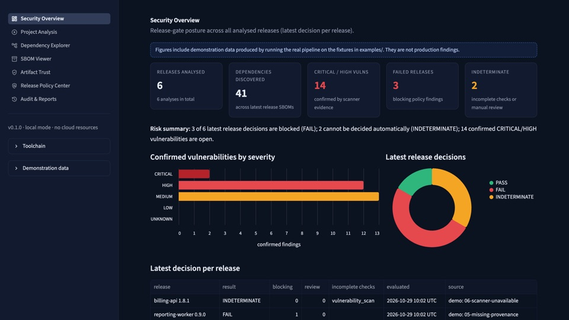
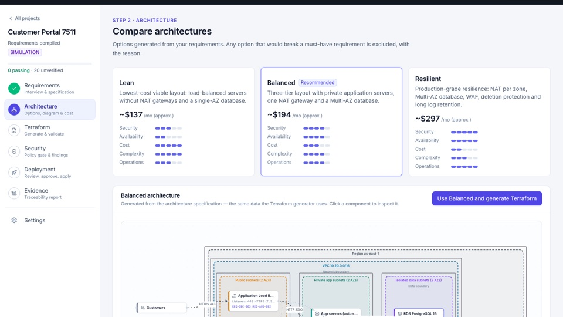
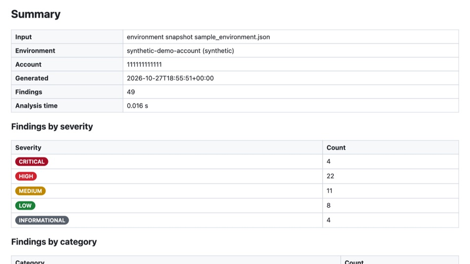
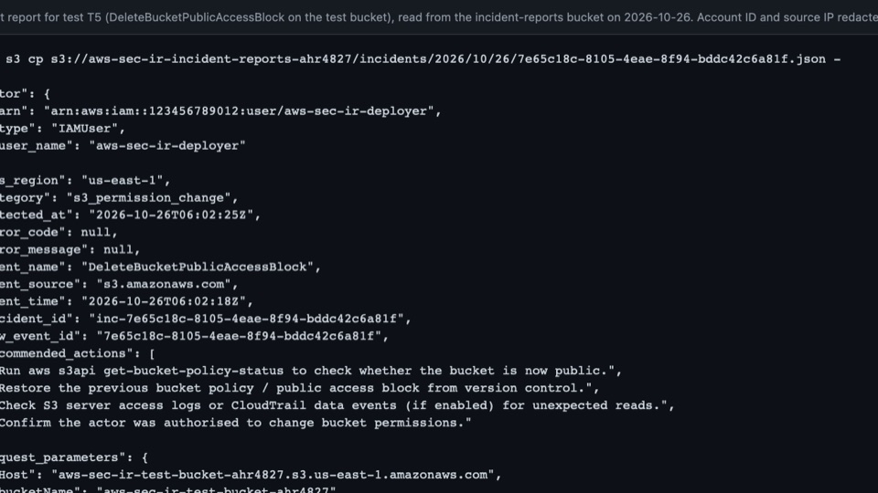
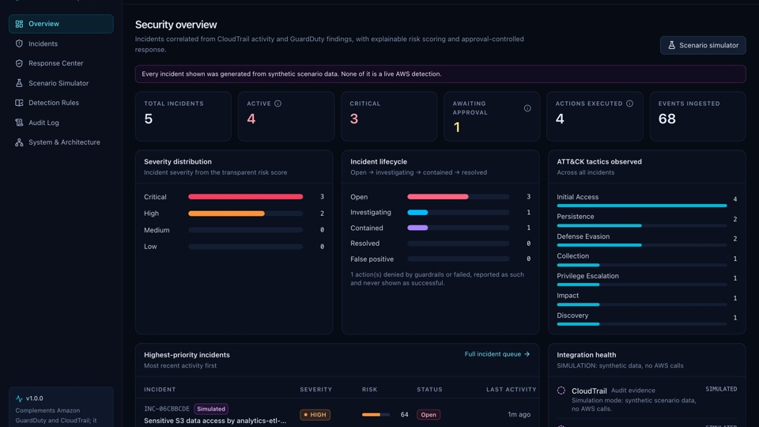
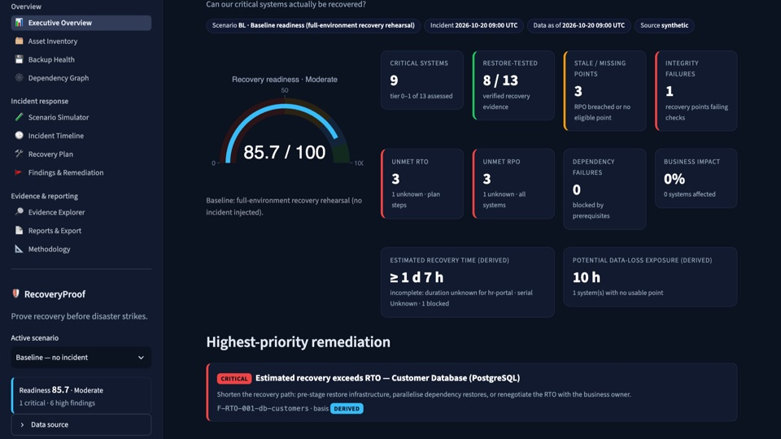
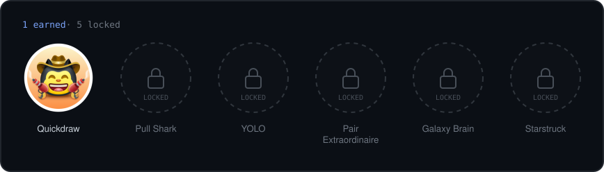

<!--
  Profile README for github.com/ahmedhany-cys

  Identity "Signal" (dark-first)
    ground  #0D1117 / #0B0F15      surface #161B22      border #21262D
    accent  #7AA2F7 (links, titles) alert   #FF9E64 (severity, streak fire only)
    text    #C0CAF5 / #8B949E
    Azure badges use labelColor 0078D4, AWS badges use 232F3E.

  Layout: who I am → what I can do → tools → work (by lifecycle stage) → how I work → activity → contact.
  Adding a project: put it in the lifecycle row it belongs to, keep two cards per row.

  Generated images
    assets/achievements.svg   .github/workflows/achievements.yml (daily, earned achievements only)
    snake on `output` branch  .github/workflows/snake.yml (daily)
  To change the rotating headline, edit the `lines=` parameter of the typing SVG.
-->

  
  
  
  
  
  
  

## About me

I'm Ahmed, a cloud security engineer. I build tools that answer the questions a security team actually gets asked: *who could reach this data, what happened in this account, is this release safe to ship, and could we recover if it all went wrong today?*

Most of my work lives on AWS, and lately on Azure too. I write it in Python and Terraform, put a FastAPI or React front end on it when people need to use it, and test it until I can show evidence for every claim it makes. When the evidence isn't there, my tools say **unknown** instead of guessing.

<table>
  <tr>
    <td width="33%" valign="top">
      <code>focus</code> 
      <b>Cloud security engineering</b> 
      IAM, detection, incident response and secure infrastructure as code
    </td>
    <td width="33%" valign="top">
      <code>recently added</code> 
      <b>Azure &amp; supply chain</b> 
      SBOMs, signed artifacts and SLSA provenance, with Key Vault-backed signing
    </td>
    <td width="33%" valign="top">
      <code>side project</code> 
      <b><a href="https://github.com/ahmedhany-cys/security-cheatsheets">Security cheatsheets</a></b> 
      16 quick references, from Nmap and Wireshark to Windows event IDs
    </td>
  </tr>
</table>

<a href="#top">back to top ↑</a>

## Skills

What I can do, and where you can check it.

| Area | What that means in practice | See it in |
|---|---|---|
| **Cloud IAM &amp; attack paths** | Evaluate IAM the way AWS does (explicit deny, boundaries, cross-account trust, conditions) and turn misconfigurations into attack paths with least-privilege fixes | [Attack Path Analyzer](https://github.com/ahmedhany-cys/aws-cloud-attack-path-analyzer) |
| **Threat detection** | Write detection rules over CloudTrail and GuardDuty, mapped to MITRE ATT&amp;CK, each with a confidence level and benign explanations to rule out | [CloudSentinel](https://github.com/ahmedhany-cys/cloudsentinel-aws-incident-response) · [Incident response](https://github.com/ahmedhany-cys/aws-cloud-security-incident-response) |
| **Incident response** | Correlate events into timelines, estimate blast radius, and run containment only through dry runs, separate-person approval and rollback | [CloudSentinel](https://github.com/ahmedhany-cys/cloudsentinel-aws-incident-response) |
| **Software supply chain** `new` | Generate CycloneDX SBOMs, check them against OSV, verify Sigstore signatures and SLSA v1 provenance, and gate releases on policy | [SupplyChain Sentinel](https://github.com/ahmedhany-cys/azure-supplychain-sentinel) |
| **Secure IaC &amp; policy as code** | Generate Terraform from requirements and block it with deterministic policies over the plan JSON, alongside Checkov and Trivy | [Infrastructure as Prompt](https://github.com/ahmedhany-cys/infrastructure-as-prompt) |
| **Cyber resilience** `new` | Model system dependencies, check backups against RTO/RPO, simulate ransomware and admin compromise, and plan a safe recovery order | [RecoveryProof](https://github.com/ahmedhany-cys/recoveryproof) |
| **DevSecOps** | CI that lints, type-checks, tests and scans every change: secrets, dependencies, containers and IaC | the `ci.yml` in each repository |
| **Security tooling UX** | Turn analysis into something people can use: CLIs with CI exit codes, REST APIs, dashboards and print-ready reports | all of the above |

<a href="#top">back to top ↑</a>

## Tech stack

  

 

<table>
  <tr>
    <td width="22%"><b>Languages</b></td>
    <td>
      
      
      
      
    </td>
  </tr>
  <tr>
    <td><b>AWS</b></td>
    <td>
      
      
      
      
      
      
      
      
    </td>
  </tr>
  <tr>
    <td><b>Azure</b> <code>new</code></td>
    <td>
      
      
      
    </td>
  </tr>
  <tr>
    <td><b>Security tooling</b></td>
    <td>
      
      
      
      
      
      
      
      
      
      
      
    </td>
  </tr>
  <tr>
    <td><b>Apps &amp; APIs</b></td>
    <td>
      
      
      
      
      
      
      
    </td>
  </tr>
  <tr>
    <td><b>Infrastructure &amp; CI</b></td>
    <td>
      
      
      
      
    </td>
  </tr>
  <tr>
    <td><b>Testing &amp; quality</b></td>
    <td>
      
      
      
      
      
      
    </td>
  </tr>
</table>

Only tools used in my public repositories are listed. Every badge links to the official documentation.

<a href="#top">back to top ↑</a>

## Selected work

Ordered by the stage of the security lifecycle each one covers, from shipping code to recovering from an incident. All are MIT licensed and tested, and the demos use synthetic data or simulation mode unless a project says otherwise.

<table>
  <tr>
    <td width="50%" valign="top">
      <code>01 · build</code> &nbsp;Is this release safe to ship? 
      
       <a href="https://github.com/ahmedhany-cys/azure-supplychain-sentinel"><b>Azure SupplyChain Sentinel</b></a> <code>new</code>
       A release gate that turns SBOM, vulnerability, signature and SLSA provenance evidence into a <b>PASS / FAIL / INDETERMINATE</b> decision under a versioned policy.
       <code>Python</code> · <code>Syft</code> · <code>OSV</code> · <code>Cosign</code> · <code>SLSA</code> · <code>FastAPI</code> · <code>Azure</code>
    </td>
    <td width="50%" valign="top">
      <code>01 · build</code> &nbsp;Is this infrastructure safe to deploy? 
      
       <a href="https://github.com/ahmedhany-cys/infrastructure-as-prompt"><b>Infrastructure as Prompt</b></a> <code>new</code>
       Plain-English requirements become traceable AWS requirements and reviewed Terraform, gated by <b>38 deterministic policies</b> over the plan JSON.
       <code>Python</code> · <code>Terraform</code> · <code>React</code> · <code>Checkov</code> · <code>Trivy</code>
    </td>
  </tr>
  <tr>
    <td width="50%" valign="top">
      <code>02 · harden</code> &nbsp;Who could reach admin or sensitive data? 
      
       <a href="https://github.com/ahmedhany-cys/aws-cloud-attack-path-analyzer"><b>AWS Cloud Attack Path Analyzer</b></a> <code>new</code>
       Offline, graph-based analysis of IAM and network exposure: a tri-state IAM evaluator, <b>22 checks</b> and least-privilege fixes, with zero runtime dependencies.
       <code>Python</code> · <code>IAM</code> · <code>graph analysis</code> · <code>boto3</code>
    </td>
    <td width="50%" valign="top">
      <code>03 · detect</code> &nbsp;Did someone just change something risky? 
      
       <a href="https://github.com/ahmedhany-cys/aws-cloud-security-incident-response"><b>AWS Cloud Security Incident Response</b></a>
       Serverless monitoring: CloudTrail → EventBridge → Lambda → S3 incident reports. Tested against a real account, where it found its own blind spot. <b>$0/month</b>.
       <code>Python</code> · <code>Terraform</code> · <code>Lambda</code> · <code>EventBridge</code>
    </td>
  </tr>
  <tr>
    <td width="50%" valign="top">
      <code>04 · respond</code> &nbsp;What happened, and what do we do now? 
      
       <a href="https://github.com/ahmedhany-cys/cloudsentinel-aws-incident-response"><b>CloudSentinel</b></a> <code>new</code>
       AWS threat detection and investigation: <b>17 rules mapped to MITRE ATT&amp;CK</b>, incident timelines, blast radius, and approval-gated containment with rollback.
       <code>Python</code> · <code>FastAPI</code> · <code>React</code> · <code>GuardDuty</code> · <code>Terraform</code>
    </td>
    <td width="50%" valign="top">
      <code>05 · recover</code> &nbsp;Could we actually come back from it? 
      
       <a href="https://github.com/ahmedhany-cys/recoveryproof"><b>RecoveryProof</b></a> <code>new</code>
       Evidence-based disaster-recovery analysis: RTO/RPO compliance, dependency-aware recovery order and <b>10 incident scenarios</b>, including ransomware.
       <code>Python</code> · <code>Streamlit</code> · <code>NetworkX</code> · <code>Plotly</code>
    </td>
  </tr>
</table>

<a href="#top">back to top ↑</a>

## How I work

The same rules run through every project above.

- **Facts, inferences and guesses stay separate.** Findings are labelled as observed, derived, hypothetical or unknown, and my tools return *indeterminate* rather than a false all-clear.
- **Test the outcome, not the deployment.** A successful `terraform apply` proves nothing about whether a rule fires. Only an observed result does.
- **Check assumptions against reality.** API names are not always event names; CloudTrail logs `PutBucketPublicAccessBlock`, not `PutPublicAccessBlock`.
- **Automation never acts alone.** Containment needs a dry run and approval from a different person; a deployment approval is bound to the hash of the exact plan that was reviewed.
- **Least privilege is a design input, not a cleanup step.** Every role gets exactly what it needs, and every unavoidable `*` gets a comment explaining why.
- **Write down the limitations.** Every project documents what it does not do. A partial result with a documented cause beats a green check nobody can trust.
- **Share evidence safely and cheaply.** Real identifiers are redacted, demos use synthetic data, and I like running whole stacks inside the free tier.

<a href="#top">back to top ↑</a>

## Activity

  
  

 

  

<b>Achievements</b>

 

  
   
  Real badges from my <a href="https://github.com/ahmedhany-cys">GitHub profile</a>, redrawn daily. Locked slots are ones I haven't earned yet.

 

| Locked achievement | How it is earned |
|---|---|
| Pull Shark | Open pull requests that get merged |
| Quickdraw | Close an issue or pull request within five minutes of opening it |
| YOLO | Merge a pull request without a review |
| Pair Extraordinaire | Co-author commits on a merged pull request |
| Galaxy Brain | Have answers accepted in GitHub Discussions |
| Starstruck | Create a repository that reaches 16 stars |

Source: <a href="https://docs.github.com/account-and-profile/setting-up-and-managing-your-github-profile/customizing-your-profile/personalizing-your-profile#displaying-achievements-on-your-profile">GitHub Docs</a>.

  Cards are generated live from public data. 
  

<!--
  Certifications: add only ones you hold, each linking to its public verification page.
  
-->

<a href="#top">back to top ↑</a>

## Contact

  
  <!--
    Add verified profiles here, then move the lines out of this comment:
    
    
  -->

 

  Built in the open. Every claim on this page links to the code or docs that back it.

