<!--
  Profile README for github.com/ahmedhany-cys

  Identity "Signal" (dark-first)
    ground  #0D1117 / #0B0F15      surface #161B22      border #21262D
    accent  #7AA2F7 (links, titles) alert   #FF9E64 (severity only)
    text    #C0CAF5 / #8B949E
    Azure badges use labelColor 0078D4, AWS badges use 232F3E.

  Layout: who I am → featured project → open source → work (by lifecycle stage) → what I can do → tools → how I work → activity → contact.
  Adding a project: put it in the lifecycle row it belongs to, keep two cards per row, and move the `new` tag to it.
  Upstream pull requests: the status badges are live from shields.io, so only add a row, never edit a status by hand.

  Generated images
    assets/achievements.svg   .github/workflows/achievements.yml (daily, earned achievements only)
    snake on `output` branch  .github/workflows/snake.yml (daily)
  To change the rotating headline, edit the `lines=` parameter of the typing SVG.
-->


  
  
  
  
  
  
  
  
  

## About me

I'm Ahmed, a cloud security engineer. I build tools that answer the questions a security team actually gets asked: *who could reach this data, who can mint a token our cloud trusts, what happened in this account or cluster, is this release safe to ship, and could we recover if it all went wrong today?*

Most of my work lives on AWS, with Azure and Kubernetes alongside it. I write it in Python and Terraform, put a FastAPI or React front end on it when people need to use it, and test it until I can show evidence for every claim it makes. When the evidence isn't there, my tools say **unknown** instead of guessing. When a scanner I use gets a case wrong, I send the fix upstream.

<table>
  <tr>
    <td width="25%" valign="top">
      <code>focus</code> 
      <b>Cloud security engineering</b> 
      IAM, detection, incident response and secure infrastructure as code
    </td>
    <td width="25%" valign="top">
      <code>recently added</code> 
      <b>Kubernetes &amp; workload identity</b> 
      Runtime detection with Falco and Cilium, and audits of OIDC trusts across AWS, GCP and Azure
    </td>
    <td width="25%" valign="top">
      <code>open source</code> 
      <b><a href="#open-source">Upstream pull requests</a></b> 
      Checks, rules and fixes for Prowler, Kubescape, Trivy and ASH
    </td>
    <td width="25%" valign="top">
      <code>side project</code> 
      <b><a href="https://github.com/ahmedhany-cys/security-cheatsheets">Security cheatsheets</a></b> 
      16 quick references, from Nmap and Wireshark to Windows event IDs
    </td>
  </tr>
</table>

<a href="#top">back to top ↑</a>

## Featured

<code>featured project</code> &nbsp;<code>04 · respond</code>

### [KubeShield](https://github.com/ahmedhany-cys/kubeshield)

**Kubernetes runtime threat detection and approval-gated response.**
Say a container drops a binary, reads its service account token and tries to reach a database in another namespace. KubeShield picks that up from Falco, Hubble and Kyverno, correlates it into one incident, and only isolates the pod after an analyst approves. Then it proves the isolation with real connections instead of trusting that a policy object exists.

<a href="https://github.com/ahmedhany-cys/kubeshield">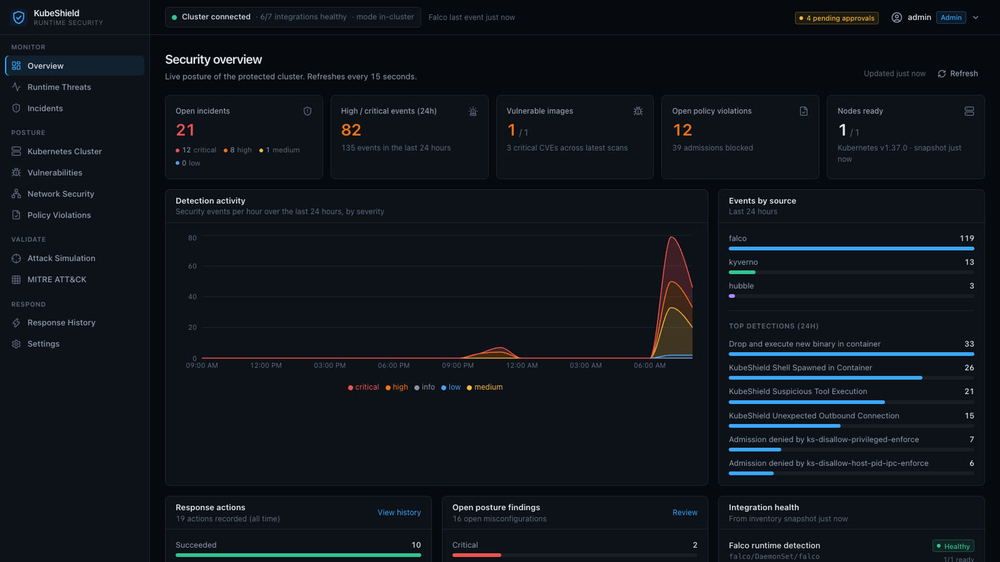</a>

<table>
  <tr>
    <td width="33%" valign="top">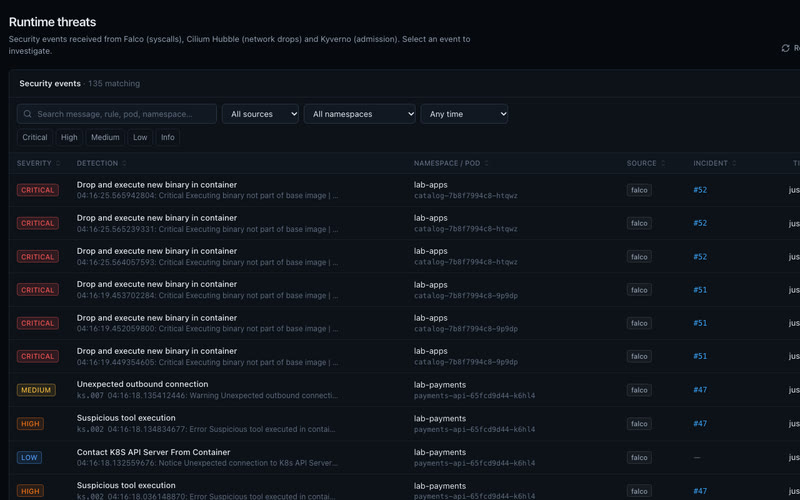 <b>Detect</b>: Falco, Hubble and Kyverno events in one normalised feed</td>
    <td width="33%" valign="top">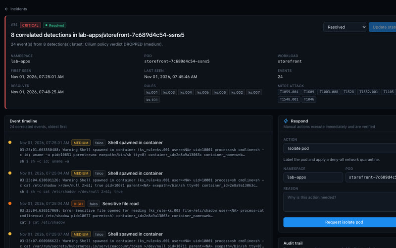 <b>Investigate</b>: detections correlated per pod, with timeline and ATT&amp;CK</td>
    <td width="33%" valign="top">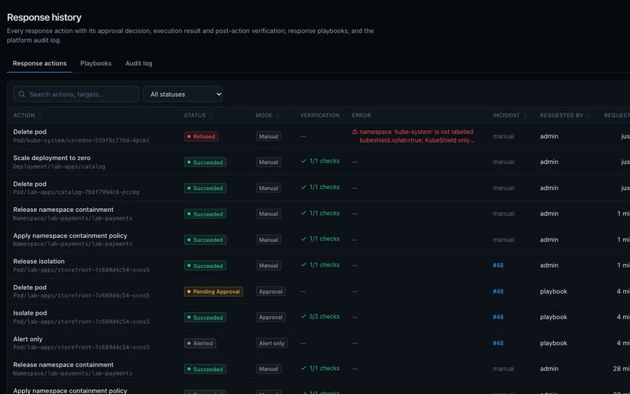 <b>Respond</b>: approval-gated actions, each verified after it runs</td>
  </tr>
</table>

  
  
  
  
  

<code>Kubernetes</code> · <code>Falco</code> · <code>Cilium / Hubble</code> · <code>Kyverno</code> · <code>Trivy</code> · <code>FastAPI</code> · <code>PostgreSQL</code> · <code>TypeScript</code> · <code>Helm</code>
  
<a href="https://github.com/ahmedhany-cys/kubeshield/blob/main/docs/validation/detection-validation-report.md">Validation report</a> ·
<a href="https://github.com/ahmedhany-cys/kubeshield#problems-found-by-testing-and-fixed">What testing broke</a> ·
<a href="https://github.com/ahmedhany-cys/kubeshield/blob/main/docs/detection-rules.md">Detection rules</a> ·
<a href="https://github.com/ahmedhany-cys/kubeshield/blob/main/docs/architecture.md">Architecture</a> ·
<a href="https://github.com/ahmedhany-cys/kubeshield/blob/main/docs/security-model.md">Security model</a> ·
<a href="https://github.com/ahmedhany-cys/kubeshield/blob/main/docs/limitations.md">Limitations</a>
 
A lab project: it runs on a local, loopback-only kind cluster and makes no production-readiness claims. Screenshots are from that lab.

  

<code>spotlight</code> &nbsp;<code>live on AWS</code>

<table>
  <tr>
    <td width="50%" valign="top">
      <a href="https://github.com/ahmedhany-cys/aws-honeytrap#live-proof-of-concept-aws-2026-10-31">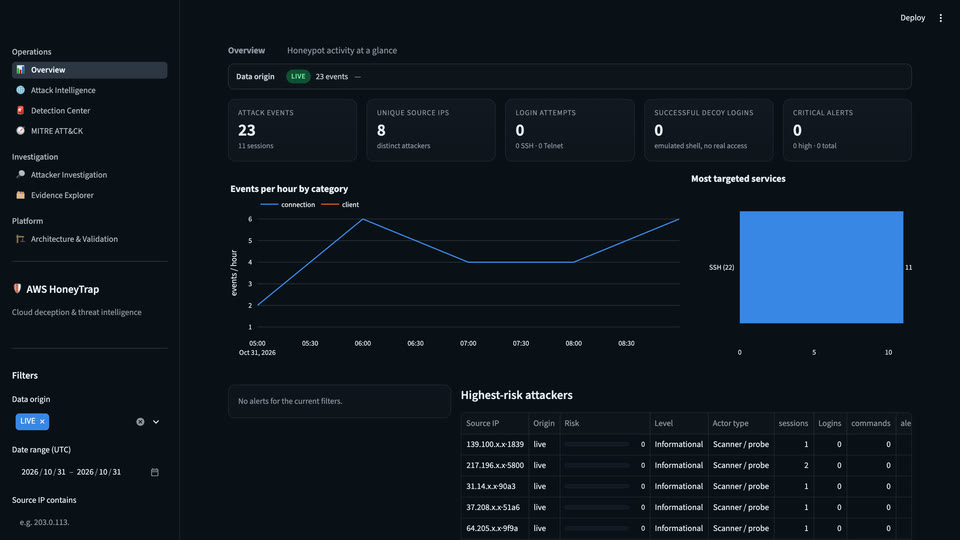</a>
    </td>
    <td width="50%" valign="top">
      <b><a href="https://github.com/ahmedhany-cys/aws-honeytrap">AWS HoneyTrap</a></b>: a honeypot I put on the real internet  
      On 2026-10-31 I deployed all <b>80 resources</b> with Terraform, left a hardened Cowrie decoy exposed for about <b>5 hours 20 minutes</b>, then tore it down and checked every resource type was gone. Cost: about <b>$0.10</b>.  
      Real scanners arrived from 8 sources and every event travelled the whole pipeline. None logged in, so none of the 18 rules fired, and the README says exactly that.  
      <a href="https://github.com/ahmedhany-cys/aws-honeytrap#live-proof-of-concept-aws-2026-10-31">Live results</a> · <a href="https://github.com/ahmedhany-cys/aws-honeytrap/blob/main/docs/evidence/live-poc/teardown-verification.txt">Teardown check</a> · <a href="https://github.com/ahmedhany-cys/aws-honeytrap/blob/main/docs/detections.md">Detections</a> · <a href="https://github.com/ahmedhany-cys/aws-honeytrap/blob/main/docs/cost-management.md">Cost</a>
    </td>
  </tr>
</table>

<a href="#top">back to top ↑</a>

## Open source

Pull requests to security scanners that other teams run in production. Each one ships with tests and follows the project's own conventions. The status badges are live.

| Project | Contribution | Language | Status |
|---|---|---|---|
|  **[Kubescape](https://github.com/kubescape/kubescape)** | [New rule `modify-admission-webhooks-v1`](https://github.com/kubescape/kubescape/pull/4509): flags RBAC that lets a subject create or change admission webhooks, with test cases for each binding shape | Rego |  |
|  **[Prowler](https://github.com/prowler-cloud/prowler)** | [New check `wafv2_webacl_managed_injection_rule_groups_enabled`](https://github.com/prowler-cloud/prowler/pull/13220): a WAFv2 web ACL should enable the AWS managed rule groups against injection | Python |  |
|  **[Prowler](https://github.com/prowler-cloud/prowler)** | [Fix: evaluate S3 secure-transport deny statements the way IAM does](https://github.com/prowler-cloud/prowler/pull/13227) | Python |  |
|  **[Trivy](https://github.com/aquasecurity/trivy)** | [Fix: apply the default TLS policy to ELB listeners that set no `ssl_policy`](https://github.com/aquasecurity/trivy/pull/11520), in both the Terraform and CloudFormation adapters | Go |  |
|  **[ASH](https://github.com/awslabs/automated-security-helper)** AWS Labs | [Fix: say when `uv sync` removes dependencies that ASH installed](https://github.com/awslabs/automated-security-helper/pull/866) | Python |  |

All my pull requests: <a href="https://github.com/pulls?q=is%3Apr+author%3Aahmedhany-cys+-user%3Aahmedhany-cys">github.com/pulls?author=ahmedhany-cys</a>

<a href="#top">back to top ↑</a>

## Selected work

Ordered by the stage of the security lifecycle each one covers, from shipping code to recovering from an incident. Every project is open source (MIT, or Apache-2.0 for KubeShield) and tested, and the demos use synthetic data or simulation mode unless a project says otherwise.

<table>
  <tr>
    <td width="50%" valign="top">
      <code>01 · build</code> &nbsp;Is this release safe to ship? 
      <a href="https://github.com/ahmedhany-cys/azure-supplychain-sentinel">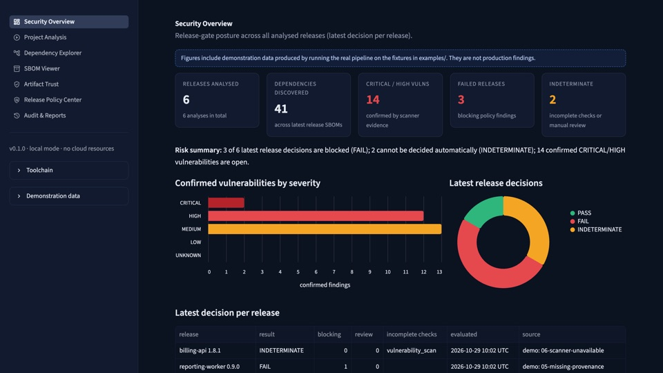</a>
       <a href="https://github.com/ahmedhany-cys/azure-supplychain-sentinel"><b>Azure SupplyChain Sentinel</b></a>
       A release gate that turns SBOM, vulnerability, signature and SLSA provenance evidence into a <b>PASS / FAIL / INDETERMINATE</b> decision under a versioned policy.
       <code>Python</code> · <code>Syft</code> · <code>OSV</code> · <code>Cosign</code> · <code>SLSA</code> · <code>FastAPI</code> · <code>Azure</code>
    </td>
    <td width="50%" valign="top">
      <code>01 · build</code> &nbsp;Is this infrastructure safe to deploy? 
      <a href="https://github.com/ahmedhany-cys/infrastructure-as-prompt">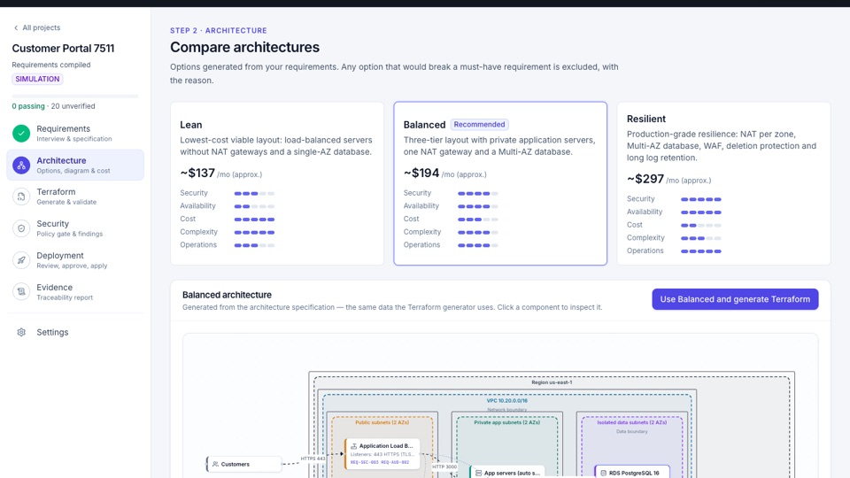</a>
       <a href="https://github.com/ahmedhany-cys/infrastructure-as-prompt"><b>Infrastructure as Prompt</b></a>
       Plain-English requirements become traceable AWS requirements and reviewed Terraform, gated by <b>38 deterministic policies</b> over the plan JSON.
       <code>Python</code> · <code>Terraform</code> · <code>React</code> · <code>Checkov</code> · <code>Trivy</code>
    </td>
  </tr>
  <tr>
    <td width="50%" valign="top">
      <code>02 · harden</code> &nbsp;Who could reach admin or sensitive data? 
      <a href="https://github.com/ahmedhany-cys/aws-cloud-attack-path-analyzer">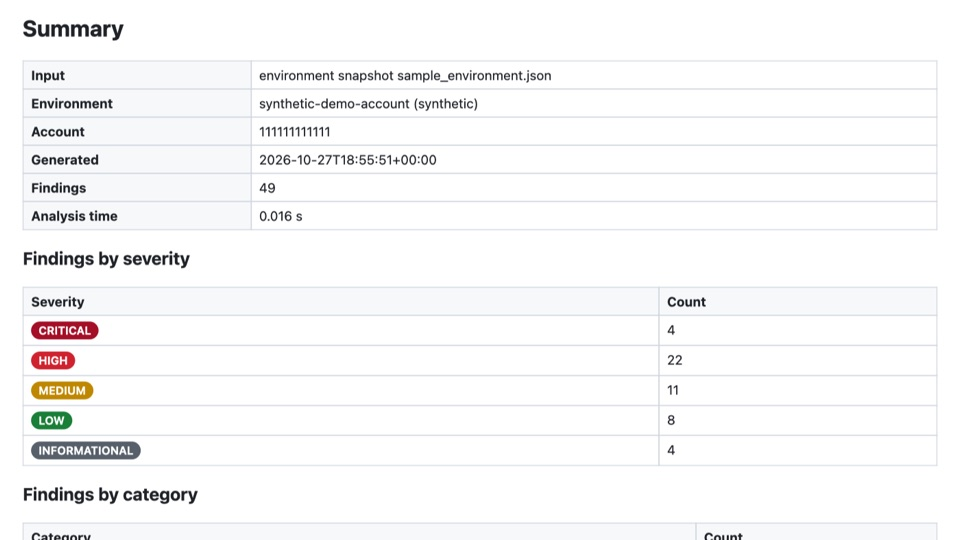</a>
       <a href="https://github.com/ahmedhany-cys/aws-cloud-attack-path-analyzer"><b>AWS Cloud Attack Path Analyzer</b></a>
       Offline, graph-based analysis of IAM and network exposure: a tri-state IAM evaluator, <b>22 checks</b> and least-privilege fixes, with zero runtime dependencies.
       <code>Python</code> · <code>IAM</code> · <code>graph analysis</code> · <code>boto3</code>
    </td>
    <td width="50%" valign="top">
      <code>02 · harden</code> &nbsp;Who can mint a token our cloud trusts? 
      <a href="https://github.com/ahmedhany-cys/trustmint">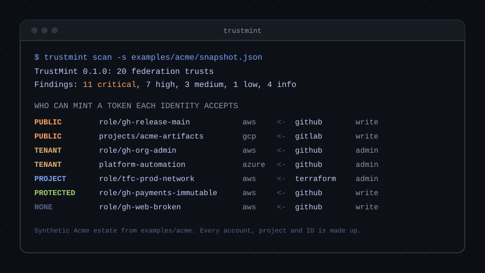</a>
       <a href="https://github.com/ahmedhany-cys/trustmint"><b>TrustMint</b></a> <code>new</code>
       Offline audit of OIDC workload identity federation from GitHub Actions, GitLab, HCP Terraform, CircleCI and EKS into AWS, GCP and Azure. Every finding is proved with a <b>witness token</b> the trust really accepts.
       <code>Python</code> · <code>OIDC</code> · <code>IAM</code> · <code>CEL</code> · <code>Terraform plans</code> · <code>SARIF</code>
    </td>
  </tr>
  <tr>
    <td width="50%" valign="top">
      <code>03 · detect</code> &nbsp;Did someone just change something risky? 
      <a href="https://github.com/ahmedhany-cys/aws-cloud-security-incident-response">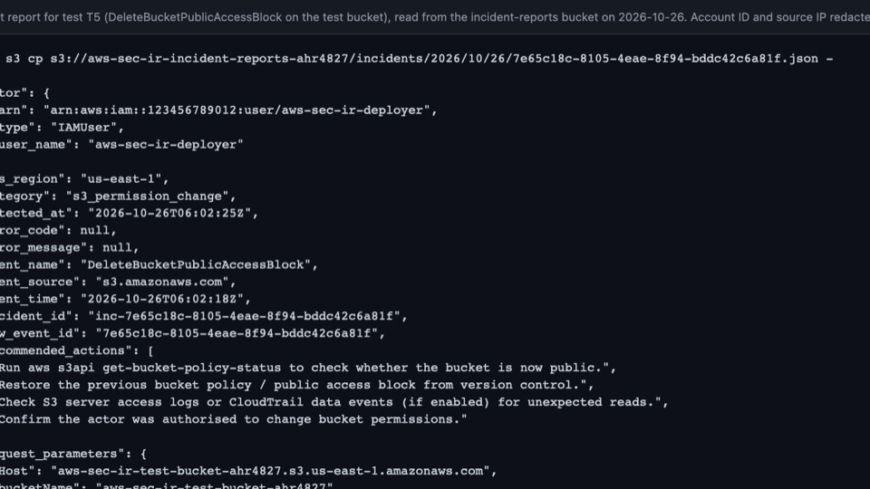</a>
       <a href="https://github.com/ahmedhany-cys/aws-cloud-security-incident-response"><b>AWS Cloud Security Incident Response</b></a>
       Serverless monitoring: CloudTrail → EventBridge → Lambda → S3 incident reports. Tested against a real account, where it found its own blind spot. <b>$0/month</b>.
       <code>Python</code> · <code>Terraform</code> · <code>Lambda</code> · <code>EventBridge</code>
    </td>
    <td width="50%" valign="top">
      <code>03 · detect</code> &nbsp;Who is knocking, and what do they try? 
      
       <a href="https://github.com/ahmedhany-cys/aws-honeytrap"><b>AWS HoneyTrap</b></a> <code>new</code> <a href="#featured"><code>live on AWS</code></a>
       A hardened Cowrie SSH/Telnet decoy feeding S3 → EventBridge → Lambda, with <b>18 detection rules</b> mapped to MITRE ATT&amp;CK. Deployed to AWS once for a live proof of concept, then torn down.
       <code>Python</code> · <code>Terraform</code> · <code>Cowrie</code> · <code>Lambda</code> · <code>Streamlit</code>
    </td>
  </tr>
  <tr>
    <td width="50%" valign="top">
      <code>04 · respond</code> &nbsp;What happened, and what do we do now? 
      <a href="https://github.com/ahmedhany-cys/cloudsentinel-aws-incident-response">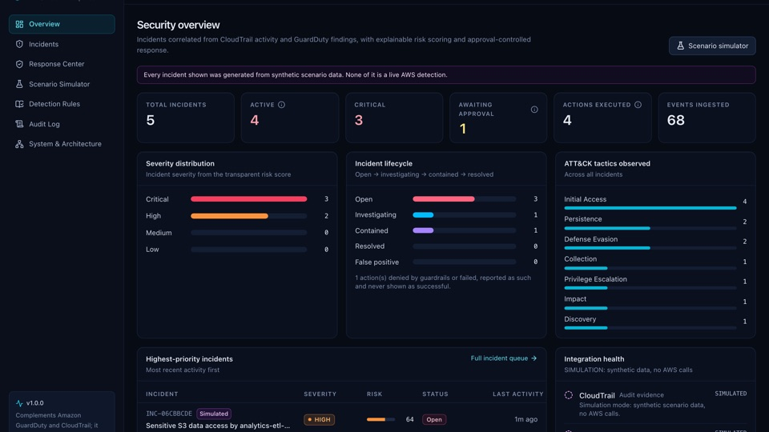</a>
       <a href="https://github.com/ahmedhany-cys/cloudsentinel-aws-incident-response"><b>CloudSentinel</b></a>
       AWS threat detection and investigation: <b>17 rules mapped to MITRE ATT&amp;CK</b>, incident timelines, blast radius, and approval-gated containment with rollback.
       <code>Python</code> · <code>FastAPI</code> · <code>React</code> · <code>GuardDuty</code> · <code>Terraform</code>
    </td>
    <td width="50%" valign="top">
      <code>04 · respond</code> &nbsp;Something is running in a pod. Contain it? 
      <a href="https://github.com/ahmedhany-cys/kubeshield">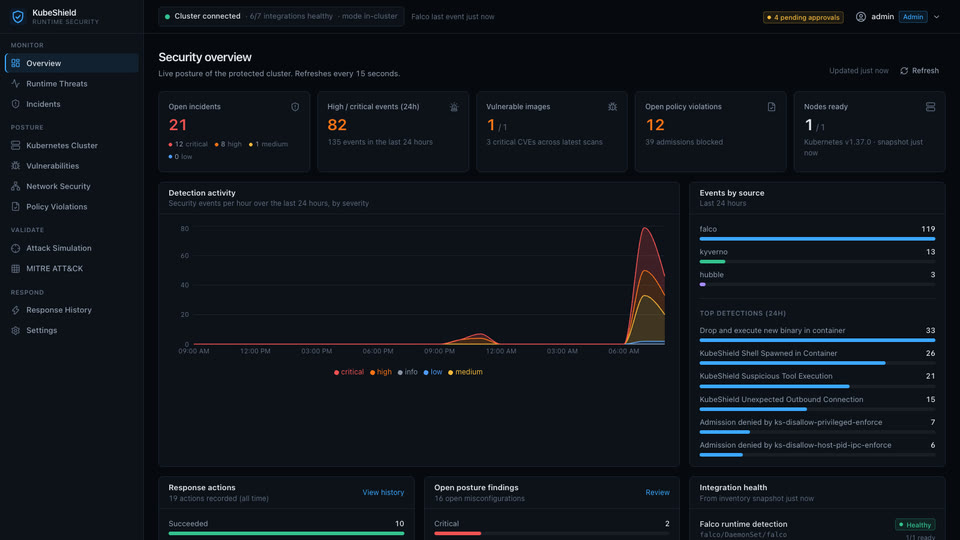</a>
       <a href="https://github.com/ahmedhany-cys/kubeshield"><b>KubeShield</b></a> <code>new</code> <a href="#featured"><code>featured</code></a>
       Kubernetes runtime detection and approval-gated response on Falco, Cilium/Hubble, Kyverno and Trivy. Containment is verified with real traffic: <b>46 of 46</b> end-to-end checks passed in the last full run.
       <code>Kubernetes</code> · <code>Falco</code> · <code>Cilium</code> · <code>Kyverno</code> · <code>FastAPI</code> · <code>TypeScript</code>
    </td>
  </tr>
  <tr>
    <td width="50%" valign="top">
      <code>05 · investigate</code> &nbsp;What does the evidence prove? 
      <a href="https://github.com/ahmedhany-cys/traceforge-digital-forensics">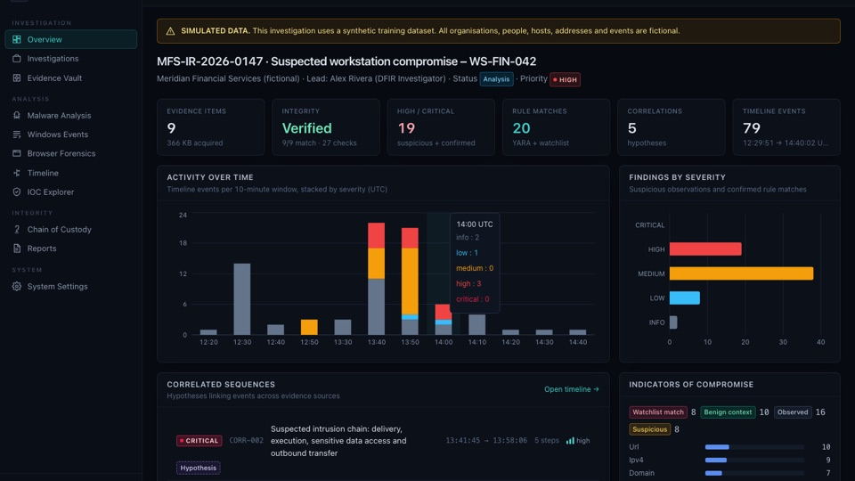</a>
       <a href="https://github.com/ahmedhany-cys/traceforge-digital-forensics"><b>TraceForge</b></a>
       Digital forensics platform: EVTX, browser, log and PE analysis, <b>YARA</b>, IOC extraction and an explainable cross-source timeline, with a hash-chained chain of custody.
       <code>Python</code> · <code>FastAPI</code> · <code>React</code> · <code>YARA</code> · <code>pefile</code>
    </td>
    <td width="50%" valign="top">
      <code>06 · recover</code> &nbsp;Could we actually come back from it? 
      <a href="https://github.com/ahmedhany-cys/recoveryproof">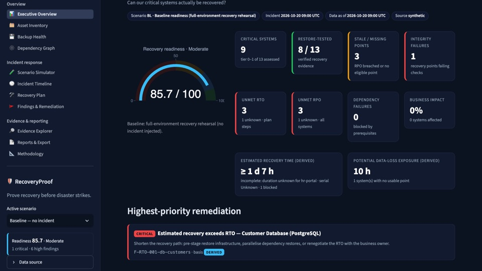</a>
       <a href="https://github.com/ahmedhany-cys/recoveryproof"><b>RecoveryProof</b></a>
       Evidence-based disaster-recovery analysis: RTO/RPO compliance, dependency-aware recovery order and <b>10 incident scenarios</b>, including ransomware.
       <code>Python</code> · <code>Streamlit</code> · <code>NetworkX</code> · <code>Plotly</code>
    </td>
  </tr>
</table>

<a href="#top">back to top ↑</a>

## Skills

What I can do, and where you can check it.

| Area | What that means in practice | See it in |
|---|---|---|
| **Cloud IAM &amp; attack paths** | Evaluate IAM the way AWS does (explicit deny, boundaries, cross-account trust, conditions) and turn misconfigurations into attack paths with least-privilege fixes | [Attack Path Analyzer](https://github.com/ahmedhany-cys/aws-cloud-attack-path-analyzer) |
| **Workload identity &amp; OIDC** `new` | Work out who can obtain a token that an AWS role, Google service account or Entra app accepts, by evaluating each cloud's own condition language, and flag CI jobs where untrusted code can mint one | [TrustMint](https://github.com/ahmedhany-cys/trustmint) |
| **Threat detection** | Write detection rules over CloudTrail, GuardDuty and honeypot telemetry, mapped to MITRE ATT&amp;CK, each with a confidence level and benign explanations to rule out | [CloudSentinel](https://github.com/ahmedhany-cys/cloudsentinel-aws-incident-response) · [Incident response](https://github.com/ahmedhany-cys/aws-cloud-security-incident-response) · [HoneyTrap](https://github.com/ahmedhany-cys/aws-honeytrap) |
| **Kubernetes security** `new` | Detect runtime threats with Falco, enforce admission policy with Kyverno, isolate pods with Cilium and prove the block with real connections; write Kubescape rules for risky RBAC | [KubeShield](https://github.com/ahmedhany-cys/kubeshield) · [Kubescape PR](https://github.com/kubescape/kubescape/pull/4509) |
| **Deception &amp; threat intelligence** `new` | Run a contained honeypot with no egress, turn its telemetry into evidence-backed alerts, and label every dataset as live, simulated or synthetic | [HoneyTrap](https://github.com/ahmedhany-cys/aws-honeytrap) |
| **Incident response** | Correlate events into timelines, estimate blast radius, and run containment only through dry runs, separate-person approval and rollback | [CloudSentinel](https://github.com/ahmedhany-cys/cloudsentinel-aws-incident-response) |
| **Digital forensics &amp; malware analysis** | Parse EVTX logs, browser history and PE files, write YARA rules, extract IOCs, rebuild a UTC timeline, and keep a hash-chained chain of custody | [TraceForge](https://github.com/ahmedhany-cys/traceforge-digital-forensics) |
| **Software supply chain** | Generate CycloneDX SBOMs, check them against OSV, verify Sigstore signatures and SLSA v1 provenance, and gate releases on policy | [SupplyChain Sentinel](https://github.com/ahmedhany-cys/azure-supplychain-sentinel) |
| **Secure IaC &amp; policy as code** | Generate Terraform from requirements and block it with deterministic policies over the plan JSON, alongside Checkov and Trivy | [Infrastructure as Prompt](https://github.com/ahmedhany-cys/infrastructure-as-prompt) |
| **Cyber resilience** | Model system dependencies, check backups against RTO/RPO, simulate ransomware and admin compromise, and plan a safe recovery order | [RecoveryProof](https://github.com/ahmedhany-cys/recoveryproof) |
| **DevSecOps** | CI that lints, type-checks, tests and scans every change: secrets, dependencies, containers and IaC | the `ci.yml` in each repository |
| **Open-source contribution** `new` | Read a large security codebase, find where a check is wrong or missing, and send a tested fix in the project's own style | [Prowler, Kubescape, Trivy, ASH](#open-source) |
| **Security tooling UX** | Turn analysis into something people can use: CLIs with CI exit codes, REST APIs, dashboards and print-ready reports | all of the above |

<a href="#top">back to top ↑</a>

## Tech stack

  

 

<table>
  <tr>
    <td width="22%"><b>Languages</b></td>
    <td>
      
      
      
      
      
      
    </td>
  </tr>
  <tr>
    <td><b>AWS</b></td>
    <td>
      
      
      
      
      
      
      
      
    </td>
  </tr>
  <tr>
    <td><b>Azure</b></td>
    <td>
      
      
      
    </td>
  </tr>
  <tr>
    <td><b>Kubernetes</b> <code>new</code></td>
    <td>
      
      
      
      
      
      
      
      
    </td>
  </tr>
  <tr>
    <td><b>Security tooling</b></td>
    <td>
      
      
      
      
      
      
      
      
      
      
      
      
      
      
      
      
      
      
      
    </td>
  </tr>
  <tr>
    <td><b>Apps &amp; APIs</b></td>
    <td>
      
      
      
      
      
      
      
      
    </td>
  </tr>
  <tr>
    <td><b>Infrastructure &amp; CI</b></td>
    <td>
      
      
      
      
    </td>
  </tr>
  <tr>
    <td><b>Testing &amp; quality</b></td>
    <td>
      
      
      
      
      
      
    </td>
  </tr>
</table>

Only tools used in my public repositories or in my upstream pull requests are listed. Every badge links to the official documentation.

<a href="#top">back to top ↑</a>

## How I work

The same rules run through every project above.

- **Facts, inferences and guesses stay separate.** Findings are labelled as observed, derived, hypothetical or unknown, and my tools return *indeterminate* rather than a false all-clear.
- **Test the outcome, not the deployment.** A successful `terraform apply` proves nothing about whether a rule fires. Only an observed result does.
- **Check assumptions against reality.** API names are not always event names; CloudTrail logs `PutBucketPublicAccessBlock`, not `PutPublicAccessBlock`.
- **Automation never acts alone.** Containment needs a dry run and approval from a different person; a deployment approval is bound to the hash of the exact plan that was reviewed.
- **Least privilege is a design input, not a cleanup step.** Every role gets exactly what it needs, and every unavoidable `*` gets a comment explaining why.
- **Write down the limitations.** Every project documents what it does not do. A partial result with a documented cause beats a green check nobody can trust.
- **Fix it where it lives.** When a scanner I rely on gets a case wrong, the fix goes upstream with tests, not into a local workaround.
- **Share evidence safely and cheaply.** Real identifiers are redacted, demos use synthetic data, and I like running whole stacks inside the free tier.

<a href="#top">back to top ↑</a>

## Activity

  
  

 

  

<b>Achievements</b>

 

  <a href="https://github.com/ahmedhany-cys">
    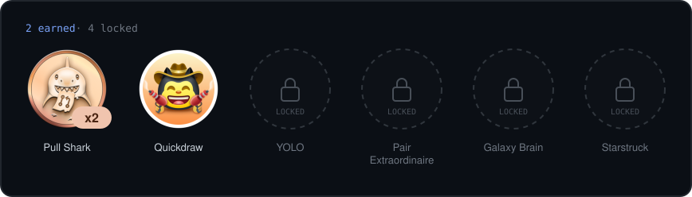
  </a>
   
  Real badges from my <a href="https://github.com/ahmedhany-cys">GitHub profile</a>, redrawn daily. Locked slots are ones I haven't earned yet.

 

| Locked achievement | How it is earned |
|---|---|
| Pull Shark | Open pull requests that get merged |
| Quickdraw | Close an issue or pull request within five minutes of opening it |
| YOLO | Merge a pull request without a review |
| Pair Extraordinaire | Co-author commits on a merged pull request |
| Galaxy Brain | Have answers accepted in GitHub Discussions |
| Starstruck | Create a repository that reaches 16 stars |

Source: <a href="https://docs.github.com/account-and-profile/setting-up-and-managing-your-github-profile/customizing-your-profile/personalizing-your-profile#displaying-achievements-on-your-profile">GitHub Docs</a>.

  Cards are generated live from public data. 
  

<!--
  Certifications: add only ones you hold, each linking to its public verification page.
  
-->

<a href="#top">back to top ↑</a>

## Contact

  
  
  <!--
    Add verified profiles here, then move the lines out of this comment:
    
    
  -->

 

  Built in the open. Every claim on this page links to the code or docs that back it.

